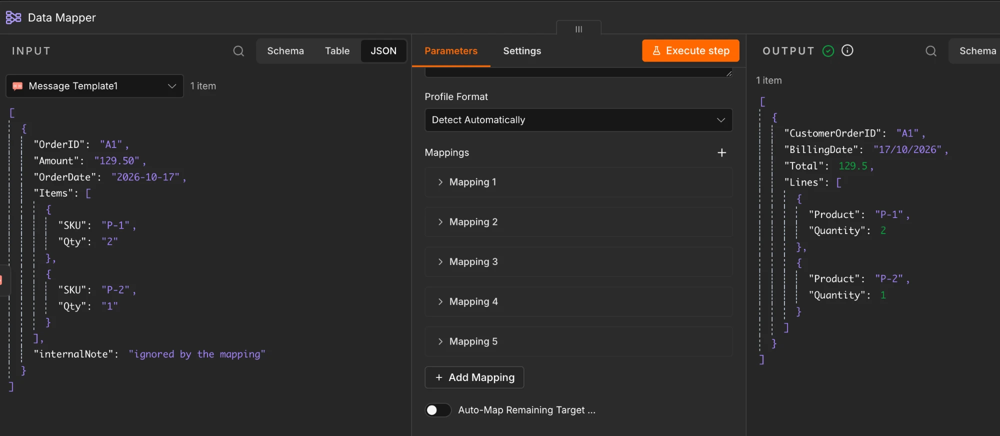
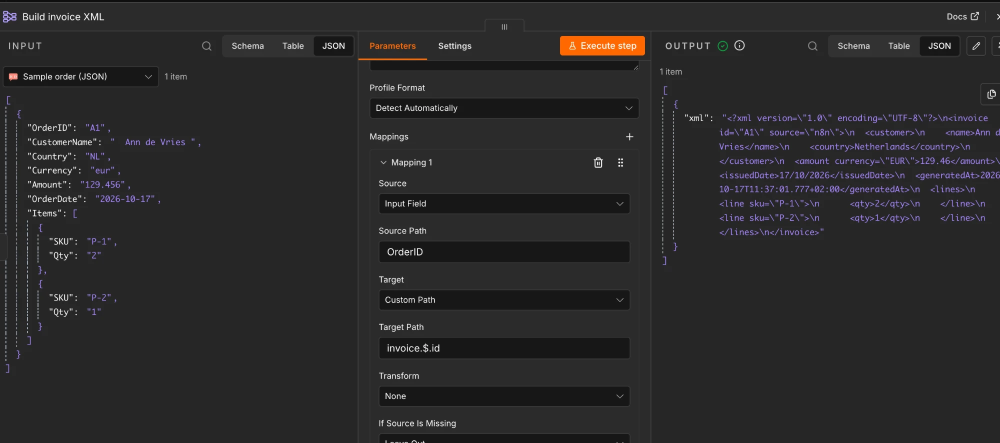

# n8n-nodes-data-mapper

[](https://www.npmjs.com/package/n8n-nodes-data-mapper)
[](https://github.com/SilentJMA/n8n-nodes-data-mapper/actions/workflows/ci.yml)
[](LICENSE)

An [n8n](https://n8n.io) community node that **maps whatever comes in onto a target structure** and outputs **XML, JSON or CSV**.

Add a mapping for each field: pick the **source** (an input path, a field from a source profile, or a fixed value/expression) and the **target** (a path you type, or a field from a target profile), with built-in **transforms** along the way. Or let **Auto-Map** match source fields to a target profile by name. Paste a profile — an XML/JSON/Flat File profile component, JSON Schema, sample JSON or XML, XSD, or a CSV header — and its fields become selectable dropdowns on both sides.

There is also a **visual drag-and-drop mapper** (node version 2); see [below](#visual-drag-and-drop-mapper-node-version-2).

Use it to turn an API response into a partner's XML order, shape database rows into a CSV export, read a supplier's XML into clean JSON, or pull the useful parts out of a large payload.

- [Screenshots](#screenshots)
- [Installation](#installation)
- [Quick start](#quick-start)
- [Paths](#paths)
- [Parameters](#parameters)
- [Transforms](#transforms)
- [Target profiles and auto-map](#target-profiles-and-auto-map)
- [Reusable JSON definitions](#reusable-json-definitions)
- [Working with XML](#working-with-xml)
- [Examples](#examples)
- [Visual drag-and-drop mapper (node version 2)](#visual-drag-and-drop-mapper-node-version-2)
- [Security](#security)
- [Compatibility](#compatibility)
- [Development](#development)
- [License](#license)

## Screenshots

**Mapping fields to a JSON output** — rename and nest fields, convert types, and reshape arrays:




**Building XML with transforms and added fields** — attributes, nested elements, repeated items, a country lookup, rounding and a generated timestamp:



## Installation

### From the n8n UI (recommended)

1. In n8n, open **Settings → Community Nodes**.
2. Select **Install**, enter `n8n-nodes-data-mapper`, accept the risk notice and install.
3. Search for **Data Mapper** in the node panel.

### Manually (self-hosted, Docker, Unraid)

The package has no runtime dependencies, so you can drop it into n8n's `custom` folder:

```bash
# inside your n8n data folder (mapped to /home/node/.n8n in the official Docker image)
mkdir -p custom && cd custom
npm pack n8n-nodes-data-mapper
tar -xzf n8n-nodes-data-mapper-*.tgz && mv package n8n-nodes-data-mapper
```

Restart n8n afterwards.

## Quick start

Given this input item:

```json
{
  "id": "A1",
  "customer": { "name": "  Ann ", "country": "NL" },
  "items": [
    { "sku": "P-1", "qty": "2" },
    { "sku": "P-2", "qty": "1" }
  ]
}
```

add these mappings:

| Source Path | Target Path | Transform |
| --- | --- | --- |
| `id` | `orderId` | |
| `customer.name` | `buyer.name` | Trim |
| `customer.country` | `buyer.country` | Lookup Table: `NL=Netherlands` |
| `items[*].sku` | `lines[*].productCode` | |
| `items[*].qty` | `lines[*].quantity` | To Integer |
| *Fixed Value* `EUR` | `lines[*].currency` | |

and get:

```json
{
  "orderId": "A1",
  "buyer": { "name": "Ann", "country": "Netherlands" },
  "lines": [
    { "productCode": "P-1", "quantity": 2, "currency": "EUR" },
    { "productCode": "P-2", "quantity": 1, "currency": "EUR" }
  ]
}
```

Import [`examples/data-mapper-examples.json`](examples/data-mapper-examples.json) into n8n (**Workflows → Import from File**) to try this and the XML examples.

## Paths

| Syntax | Meaning |
| --- | --- |
| `customer.name` | Nested field |
| `items[0].sku` | One array element |
| `items[*].sku` | Every array element |
| `["first name"]` or `data["x-id"]` | Keys with spaces or special characters |
| *(empty)* | The whole input (source) or the whole output (target, value must be an object) |

How `[*]` in the source and target line up:

- **Same number of `[*]`**: elements are matched by position. `items[*].sku` → `lines[*].code` writes `lines[0].code`, `lines[1].code`, … Mappings that share a target array build up the same elements, so several mappings can fill in one array of objects.
- **Fewer `[*]` in the target**: the extra levels are collected into a list. `items[*].sku` → `skus` gives `["P-1", "P-2"]`. `orders[*].items[*].sku` → `orders[*].skus` gives one list per order, and an empty list for an order with no items.
- **More `[*]` in the target**: not allowed, except for a fixed value, which is written to every existing element (`EUR` → `lines[*].currency`).
- A single object where `[*]` expects an array is treated as a one-element array. This matters for XML, where one child element is not an array.

Mappings run in order, and a later mapping to the same target overwrites an earlier one.

## Parameters

| Parameter | Description |
| --- | --- |
| **Input** | *Item JSON* maps each incoming item. *Text Field* first parses JSON or XML text stored in a field. *File* first parses a JSON or XML binary file. |
| **Input Field** / **Input Binary Field** | Which field holds the text or file. |
| **Input Format** | *Detect Automatically* (XML when the text starts with `<`), *JSON* or *XML*. |
| **Define Mappings** | *Map Each Column Manually*, *Auto-Map From Profile*, or *Using JSON*. See [Target profiles and auto-map](#target-profiles-and-auto-map) and [Reusable JSON definitions](#reusable-json-definitions). |
| **Target Profile** / **Target Profile Format** | Optional. The structure to map into. See [Target profiles and auto-map](#target-profiles-and-auto-map). |
| **Source Profile** / **Source Profile Format** | Optional (*Map Each Column Manually*). The structure of the incoming data, so each mapping can use **Source: From Source Profile** and pick the field from a dropdown. |
| **Mappings** | The list of mappings. Each has a **Source** (*Input Field* path, *From Source Profile* dropdown, or *Fixed Value*, which can be an expression), a **Target** (*Custom Path* you type, or *From Target Profile* picked from a dropdown), an optional **Transform**, and **If Source Is Missing**: *Leave Out* (default), *Set to Null*, *Use Default* or *Stop With Error*. |
| **Transform a Field** | *Fill Target Fields.* Pick a target field and apply a transform (trim, number, date, lookup, split/join, ...). Shown as a list under the fields. |
| **CSV Options** | *CSV / CSV File output.* Delimiter, header row, line ending, one CSV for all items, and formula escaping. |
| **Mapping Layout** | *Map Each Column Manually.* *One Mapping at a Time* (row-by-row list) or *Fill Target Fields* — lists every target-profile field and you set the source for each (from the Source Profile dropdown, a drag, or an expression). For **static text**, hover the field, switch it to **Expression** and type the text; plain text there is used as-is. The dropdown's *(Static Text …)* entry is a reminder of this and maps nothing. On nodes saved before this version, use **Target Fields → ⋮ → Refresh Target field List** to see that entry. **Switching Define Mappings or Mapping Layout clears the mappings of the other option** (n8n removes hidden settings, and undo does not restore them), so duplicate the node before experimenting. |
| **Auto-Map Remaining Target Fields** | *One Mapping at a Time.* Fills any profile fields you did not map by hand by matching them by name. Tuned by **Auto-Map Options** (confidence, synonyms, report, ...). |
| **Unmapped Fields** | *Drop* outputs only mapped fields. *Keep* starts from a copy of the input and applies the mappings on top. |
| **Output Format** | *JSON* (the item), *JSON File*, *XML* (text in a field), *XML File*, *CSV* (text in a field) or *CSV File*. |
| **Put Output in Field** | *XML only.* Default `xml`. |
| **Put Output File in Field** / **File Name** | *File outputs only.* Defaults `data` and `output.xml` / `output.json`. |
| **Root Element** | *XML outputs only.* Leave empty to use the single top-level field as the root, or `root` when there are several. |
| **Include XML Declaration** | *XML outputs only.* Adds `<?xml version="1.0" encoding="UTF-8"?>`. |

Turn on **Settings → On Error → Continue** to output failed items as `{ "error": "…" }`. Every error names the mapping that caused it, e.g. `Mapping 3 (→ lines[*].quantity): Cannot convert "two" to a number`.

## Transforms

| Transform | Options | Example |
| --- | --- | --- |
| None | | |
| To String | | `42` → `"42"`; objects become JSON text |
| To Number | | `"10.5"` → `10.5` (fails on non-numbers) |
| To Integer | | `"10.9"` → `10` |
| Round | Decimal Places | `10.456` → `10.46` |
| To Boolean | | `yes`/`no`, `true`/`false`, `1`/`0`, `on`/`off`, `y`/`n` |
| Trim, Uppercase, Lowercase | | Also applied to every string in a list |
| Format Date | Input Date Format, Output Date Format | `20261017` with `yyyyMMdd` → `17/10/2026` with `dd/MM/yyyy`. Empty input format reads ISO 8601 or Unix milliseconds; empty output format writes ISO 8601. Tokens: `yyyy MM dd HH mm ss SSS`, in UTC. |
| Split Into List | Separator | `"a, b"` → `["a", "b"]` |
| Join List | Separator | `["a", "b"]` → `"a,b"`. With `items[*].sku` → `skuList` it joins the collected list. |
| Lookup Table | Lookup Table, If No Match | Table as `key=value` lines or a JSON object. If no match: *Keep Original Value*, *Use Default*, *Set to Null* or *Stop With Error*. |
| Concatenate | Concatenate Template | Builds text from the value, fixed text and other fields: `{value}` is this value, `{path}` reads another input field. `{value} {lastName}` → `"Ann Lee"`; `{value}-{lines[*].size}` uses the size from the same list element. A template without `{value}`, such as `Order {id}`, ignores the value. |

For anything else, use a **Fixed Value** with an expression, e.g. `{{ $json.first + ' ' + $json.last }}`.

## Target profiles and auto-map

A **target profile** describes the structure you want to map into. Paste it into the **Target Profile** field (or reference an uploaded file with an expression — see below). The node reads it and gives you two things: a **dropdown of target fields** in manual mode, and **auto-map**, which matches your source fields to the profile for you.

### Supported formats

**Target Profile Format** is *Detect Automatically* by default. Supported:

| Format | Notes |
| --- | --- |
| Profile Component (XML/JSON/Flat File) | Integration profile components exported as XML, with `type="profile.xml"`, `"profile.json"` or `"profile.flatfile"`. Attributes become `.$.name`, repeating elements become `[*]`, and the JSON profile's `Root`/`Object` wrappers are skipped. |
| JSON Schema | `properties`, `required`, `items`, `type` and `format` (date/date-time → datetime). |
| Sample JSON | A representative JSON document; array object fields are merged into one shape. |
| Sample XML | A representative XML document; attributes become `.$.name`. |
| XSD | `xs:element` / `xs:complexType` / `xs:attribute`, with `maxOccurs` for repeating elements. |
| CSV Header | The first line, split on comma, semicolon, tab or pipe. |

### Paste or upload

**Provide Target Profile** has two options:

- **Paste It** — paste the profile text into the box. This is the only source that fills the target-field dropdown.
- **Upload a File** — read the profile from an uploaded file. Put a node that produces a binary file before Data Mapper (for example **Read/Write Files From Disk**, a **Form Trigger** with a file-upload field, or an **HTTP Request**), then name that binary field. Auto-map reads the uploaded file directly; to pick fields from the dropdown, paste the profile instead.

### Picking targets (manual mode)

With **Define Mappings** = *Map Each Column Manually*, paste a profile, then set a mapping's **Target** to *From Target Profile* and choose the field from the dropdown. The dropdown shows each field's path, whether it is a list, and its type. Switch **Target** to *Custom Path* to type a path the profile does not contain.

### Auto-map

With **Define Mappings** = *Auto-Map From Profile*, the node matches each target field to the best source field by name and builds the mapping automatically. The target's type becomes the transform (a `number` field gets *To Number*, a `datetime` field gets *Format Date*, and so on).

**Auto-Map Options** (shown for *Auto-Map From Profile*, and for *One Mapping at a Time* once **Auto-Map Remaining Target Fields** is on):

| Option | Default | Description |
| --- | --- | --- |
| Minimum Confidence | 0.6 | How close names must be, from 0 (anything) to 1 (identical). Names are compared ignoring case and punctuation. |
| Match | Fuzzy | *Fuzzy* allows similar names; *Exact Names Only* requires the same name. |
| Case Sensitive | off | Whether names must match in the same case. |
| Reuse a Source for Several Targets | off | Whether one source may fill more than one target. |
| Unmatched Target Fields | Leave Out | *Leave Out*, or *Set to Null* to include them as null. |
| Add Auto-Map Report | off | Adds an `_autoMap` field listing matched and unmatched fields (JSON output). |

Auto-map respects arrays: `items[*].Qty` → `lines[*].qty` works, and a non-repeating source is never mapped onto a repeating target. To tweak a few fields by hand, use *Map Each Column Manually* with **Auto-Map Remaining Target Fields** on — your manual mappings win, and the rest are filled in automatically.

For an XML target profile, the root element name comes from the profile, so XML output needs no **Root Element**.

## Reusable JSON definitions

Set **Define Mappings** to **Using JSON** to describe the mapping as data. You can paste it in, or load it with an expression so one mapping is shared by many workflows. For example, `{{ $('Get mapping').item.json.mapping }}` can read it from a database row, a file or a static data node.

```json
[
  { "source": "id", "target": "orderId" },
  { "source": "customer.name", "target": "buyer.name", "transform": "trim" },
  { "source": "items[*].sku", "target": "lines[*].productCode" },
  { "source": "items[*].qty", "target": "lines[*].quantity", "transform": "integer" },
  { "source": "created", "target": "orderDate", "transform": "date", "dateInputFormat": "yyyyMMdd", "dateOutputFormat": "yyyy-MM-dd" },
  { "source": "customer.country", "target": "buyer.country", "transform": "lookup", "lookup": { "NL": "Netherlands" }, "lookupFallback": "keep" },
  { "source": "note", "target": "comment", "ifMissing": "default", "default": "" },
  { "value": "EUR", "target": "lines[*].currency" }
]
```

`{ "mappings": [ … ] }` also works. Available properties per mapping:

| Property | Values |
| --- | --- |
| `target` | Target path (required) |
| `source` | Source path |
| `value` | Fixed value, used instead of `source` |
| `transform` | `none`, `string`, `number`, `integer`, `round`, `boolean`, `trim`, `uppercase`, `lowercase`, `date`, `split`, `join`, `lookup` |
| `ifMissing` | `skip` (default), `null`, `default`, `error` |
| `default` | Value for `ifMissing: "default"` |
| `separator` | For `split` and `join` (default `,`) |
| `decimals` | For `round` |
| `dateInputFormat`, `dateOutputFormat` | For `date` |
| `lookup` | Object or `key=value` lines, for `lookup` |
| `lookupFallback` | `keep` (default), `default`, `null`, `error` |
| `lookupDefault` | Value for `lookupFallback: "default"` |
| `template` | For `concat`, e.g. `"{value} {customer.lastName}"` |

Unknown properties are rejected, so a typo such as `"tranform"` fails loudly instead of being ignored.

## Working with XML

XML input is converted with the same conventions as n8n's XML node: attributes go under `$` and an element's text, when it also has attributes or children, goes under `_`.

```xml
<order ID="7">
  <line><sku>A</sku><qty>3</qty></line>
  <line><sku>B</sku><qty>1</qty></line>
  <total currency="EUR">12.50</total>
</order>
```

| Value | Path |
| --- | --- |
| `7` | `order.$.ID` |
| every SKU | `order.line[*].sku` |
| `12.50` | `order.total._` |
| `EUR` | `order.total.$.currency` |

XML output works the other way round. Write to `$` for attributes, `_` for text, and a list becomes repeated elements:

| Source Path | Target Path |
| --- | --- |
| `id` | `order.$.id` |
| `items[*].sku` | `order.line[*].$.sku` |
| `items[*].qty` | `order.line[*].quantity` |

```xml
<?xml version="1.0" encoding="UTF-8"?>
<order id="A1">
  <line sku="P-1">
    <quantity>2</quantity>
  </line>
  <line sku="P-2">
    <quantity>1</quantity>
  </line>
</order>
```

Special characters are escaped automatically. Invalid XML input fails with the line and column of the problem.

## Examples

The [`examples/`](examples) folder has importable workflows (**Workflows → Import from File**). The easiest way to build a flow, though, is to add **Data Mapper** from the node panel directly.

| File | Shows |
| --- | --- |
| [`examples/data-mapper-examples.json`](examples/data-mapper-examples.json) | JSON, XML and CSV output side by side |
| [`examples/auto-map-with-profile.json`](examples/auto-map-with-profile.json) | Auto-map and the profile-field dropdown |
| [`examples/fixed-workflow.json`](examples/fixed-workflow.json) | Field mapping to JSON (the first screenshot above) |
| [`examples/xml-output-workflow.json`](examples/xml-output-workflow.json) | Building XML with transforms and added fields (the second screenshot above) |

> **Importing a workflow and the node shows as `?`** — the node type in a workflow file depends on how the package was installed. Installed through **Settings → Community Nodes**, the type is `n8n-nodes-data-mapper.dataMapper` (what the files in `examples/` use). Installed by copying into n8n's **custom** folder, n8n registers it as `CUSTOM.dataMapper` instead. If an imported workflow shows `?`, either add the node from the panel, or edit the file and swap the type prefix to match your install. [`examples/fixed-workflow.json`](examples/fixed-workflow.json) and [`examples/xml-output-workflow.json`](examples/xml-output-workflow.json) use the `CUSTOM.` prefix.

### Build an XML invoice with transforms

This is the second screenshot above ([`examples/xml-output-workflow.json`](examples/xml-output-workflow.json)). From an order like `{ "OrderID": "A1", "CustomerName": " Ann de Vries ", "Country": "NL", "Currency": "eur", "Amount": "129.456", "OrderDate": "2026-10-17", "Items": [...] }`, these mappings (Output Format **XML**):

| Source | Target | Transform |
| --- | --- | --- |
| `OrderID` | `invoice.$.id` | |
| *Fixed* `n8n` | `invoice.$.source` | |
| `CustomerName` | `invoice.customer.name` | Trim |
| `Country` | `invoice.customer.country` | Lookup `NL=Netherlands` |
| `Amount` | `invoice.amount._` | Round (2) |
| `Currency` | `invoice.amount.$.currency` | Uppercase |
| `OrderDate` | `invoice.issuedDate` | Format Date `dd/MM/yyyy` |
| *Fixed* `{{ $now.toISO() }}` | `invoice.generatedAt` | |
| `Items[*].SKU` | `invoice.lines.line[*].$.sku` | |
| `Items[*].Qty` | `invoice.lines.line[*].qty` | To Integer |

produce:

```xml
<?xml version="1.0" encoding="UTF-8"?>
<invoice id="A1" source="n8n">
  <customer>
    <name>Ann de Vries</name>
    <country>Netherlands</country>
  </customer>
  <amount currency="EUR">129.46</amount>
  <issuedDate>17/10/2026</issuedDate>
  <generatedAt>2026-10-17T09:00:00.000Z</generatedAt>
  <lines>
    <line sku="P-1"><qty>2</qty></line>
    <line sku="P-2"><qty>1</qty></line>
  </lines>
</invoice>
```

### Distill a large API response

Keep three fields from a big payload: **Unmapped Fields** *Drop*, with mappings `data.user.id` → `id`, `data.user.profile.email` → `email` (Lowercase) and `data.user.roles[*].name` → `roles`.

### Convert JSON to an XML file for an SFTP upload

**Output Format** *XML File*, **Root Element** `invoice`, **File Name** `{{ $json.number }}.xml`, then connect an FTP node.

### Normalize data from several sources

Put one Data Mapper on each source branch, each mapping into the same target shape, then merge the branches.

## Visual drag-and-drop mapper (node version 2)

> **Not the default.** New Data Mapper nodes use the classic field mappings above. The visual mapper is **node version 2**, kept so nodes already built with it keep working. It turns the node into a drag-and-drop mapper:

```
 INPUT panel (whatever comes in)        Data Mapper (target profile)
 ───────────────────────────────        ──────────────────────────────
 OrderID          "A1"      ──drag──▶   order › @id
 Currency         "eur"     ──drag──▶   order › currency
 Items[0].SKU     "P-1"     ──drag──▶   order › line[] › sku
 Items[0].Qty     "2"       ──drag──▶   order › line[] › quantity (number)
```

1. **Output Format** — pick **XML**, **JSON** or **CSV**.
2. **Source Data** — *Incoming Item* (default), or *XML or JSON Text in a Field* / *XML or JSON File* when the order arrives as raw text, e.g. in a `data` field.
3. **Source Profile** (optional) — paste the structure of the incoming data, such as a sample order. Every target field then gets a **dropdown of source fields**, like picking the source side of a line in a visual mapper. You can still switch any field to an expression.
4. **Target Profile** — paste the profile. Its fields load into **Target Fields** as a tree (`order › line[] › @sku`): `›` separates levels, `[]` marks a repeating element, `@` an XML attribute, `(number)` a type and `*` a required field.
5. **Target Fields** — for each target field, pick the source field from the dropdown (with a Source Profile), or drag a field from the **Input** panel and drop it into the box. Or set the mode to **Map Automatically** and the node matches source fields to target fields by similar names (`OrderID` → `orderId`, `Qty` → `quantity`).
6. Run the node.

A source profile made from a one-item sample still maps every item of a real order: when a picked field sits inside a list in the actual data (`orders.order.lines.line.sku` with several `line`s), each element becomes its own target element.

What a drop can be:

| You put in a target box | What happens |
| --- | --- |
| A field picked from the Source Profile dropdown | That field is copied across (lists included). |
| A dragged field, `{{ $json.OrderID }}` | That field is copied across. |
| A dragged field from a list, `{{ $json.Items[0].SKU }}`, on a repeating target (`line[]`) | Every element is mapped, not just the first: one `line` per item. |
| A dragged single field on a repeating target, e.g. `{{ $json.Currency }}` → `line[] › currency` | The value is written into every line. |
| Any expression, e.g. `{{ $json.Currency.toUpperCase() }}` or `{{ $now.toISO() }}` | Its result is used. Expressions work like map functions: `.trim()`, `.toUpperCase()`, `.toNumber()`, `.toDateTime().toFormat('dd/MM/yyyy')`, a lookup object `{{ ({ NL: 'Netherlands' })[$json.Country] }}`, and so on. |
| An expression returning a list on a repeating target, e.g. `{{ $json.Items.map(i => i.SKU) }}` | Element `n` of the list goes to element `n` of the target. |
| Fixed text, e.g. `n8n` | Written as-is. |
| Nothing | The target field is left out (turn on **Keep Empty Values** to write it empty). |

The output always follows the **order of the target profile**, which matters to XML consumers and XSD validation. Numbers and booleans are converted where the profile says so (**Convert Types From Profile**); a value that can't be converted is kept as it is instead of failing the run.

### Output

| Output Format | Output To: Item | Output To: File |
| --- | --- | --- |
| JSON | The mapped data becomes the item | `output.json` |
| XML | XML text in the `xml` field | `output.xml` |
| CSV | CSV text in the `csv` field | `output.csv` |

CSV columns follow the profile. By default every incoming item becomes rows in **one CSV**, with a header row. A repeating target (`lines[]`) gives one row per element, with the other columns repeated.

### Options

| Option | Default | Description |
| --- | --- | --- |
| Add Auto-Map Report | off | Adds `_autoMap` with matched and unmatched fields (Map Automatically, JSON output). |
| Auto-Map Minimum Confidence | 0.6 | How close names must be, 0 to 1. |
| Custom Synonyms | | Extra `source=target` name matches, one per line or a JSON object. |
| Convert Types From Profile | on | Turn values into numbers/booleans where the profile says so. |
| CSV Delimiter / Header Row / Line Ending | `,` / on / LF | CSV formatting. |
| Escape CSV Formulas | off | Put `'` in front of values starting with `=`, `+`, `-`, `@`, tab or CR, so spreadsheets don't run them as formulas (CSV injection). |
| Include XML Declaration | on | Start XML with `<?xml version="1.0" encoding="UTF-8"?>`. |
| Keep Empty Values | off | Write empty target fields instead of leaving them out. |
| One CSV for All Items | on | One CSV for the whole run, or one per item. |
| Profile Format / Source Profile Format | Detect Automatically | Force a profile type if detection guesses wrong. |
| Read Profile From Binary Field | | Read the profile from an uploaded file at run time (works with Map Automatically; to drag and drop, paste the profile). |
| Root Element | | XML root name. Defaults to the root of a sample-XML target profile. |

### Tips

- **CSV, Excel or other files coming in?** Put an **Extract from File** node first so each row becomes an item you can drag from.
- **Input is raw XML in a field and you can't drag from it?** Set **Source Data** to *XML or JSON Text in a Field* and paste a **Source Profile**: you then pick source fields from dropdowns.
- **The field list is empty?** It loads from the pasted profile. If the profile comes from an expression, n8n can't list its fields at design time: paste it, or use Map Automatically.
- **Changed the profile?** Use the refresh button above the target fields to reload them.
- Existing workflows keep the **classic mode** (node version 1) described below. Nothing changes for them.

## Security

- **No runtime dependencies.** The published package is only the compiled node; nothing else is installed into your n8n.
- **Safe XML parsing.** DTDs and entity declarations are ignored, so there are no external entities (XXE) and no entity expansion. Only the five standard entities and numeric references are decoded. Nesting deeper than 1,000 levels is rejected with a clear error.
- **No prototype pollution.** Field names and paths such as `__proto__` or `constructor`, whether they come from mappings, profiles, lookup tables or the data itself, are treated as plain data and never reach `Object.prototype`.
- **No code execution.** Mappings, profiles and lookup tables are data; the node never evaluates them. Expressions are evaluated by n8n itself, as in any other node.
- **CSV injection.** Turn on **Escape CSV Formulas** when the CSV will be opened in a spreadsheet and contains untrusted values.

## Compatibility

- n8n 1.x and 2.x (Nodes API version 1)
- Node.js 20.15 or newer for development

## Development

```bash
git clone https://github.com/SilentJMA/n8n-nodes-data-mapper.git
cd n8n-nodes-data-mapper
npm install --ignore-scripts
npm run dev     # local n8n at http://localhost:5678 with the node loaded
npm run lint
npm test
```

See the [wiki](docs/Home.md) for full documentation, [CONTRIBUTING.md](CONTRIBUTING.md) for the project layout and release process, and [CHANGELOG.md](CHANGELOG.md) for version history.

## License

[MIT](LICENSE)
