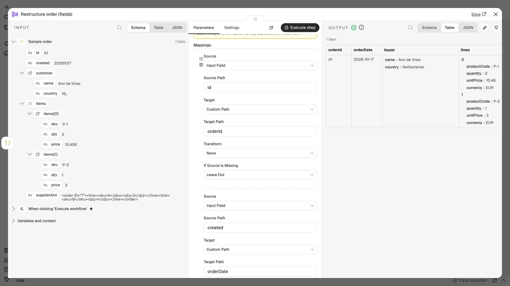
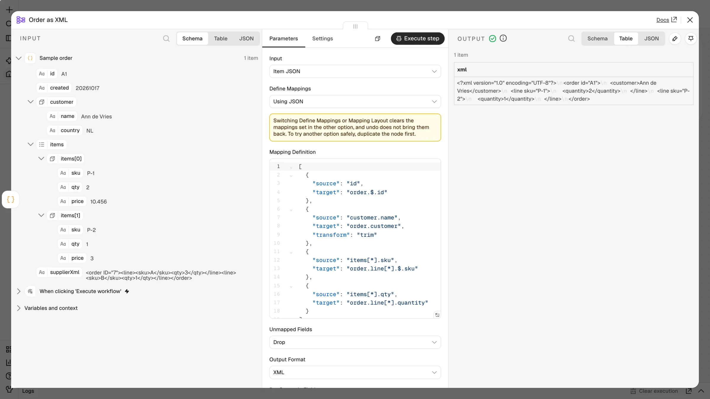
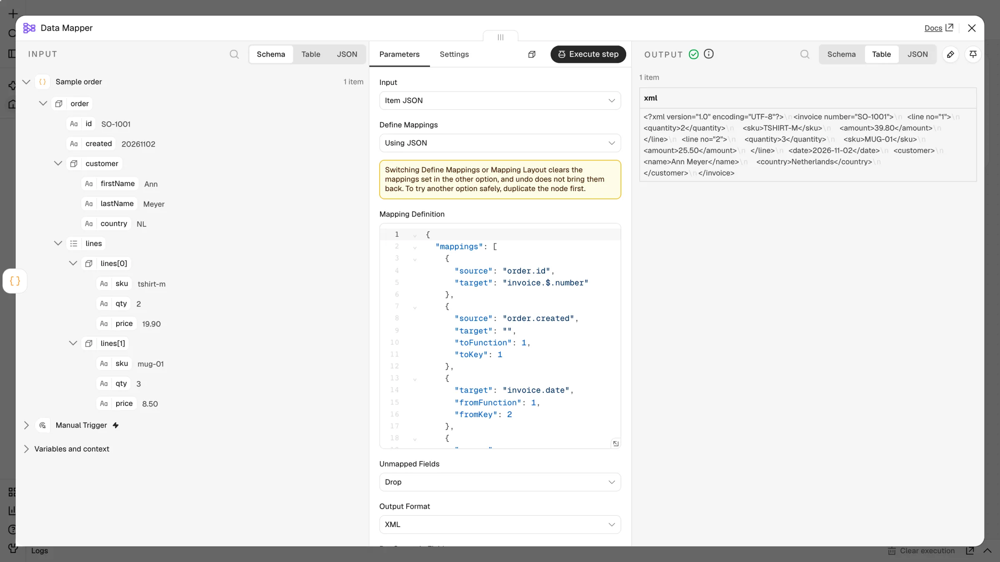

# Examples

Import the files from the [`examples/`](../examples) folder (**Workflows → Import from File**), or add **Data Mapper** from the node panel.

| File | Shows |
| --- | --- |
| `data-mapper-examples.json` | Field mappings to JSON, reading supplier XML, and a JSON definition to XML (the screenshots below) |
| `auto-map-with-profile.json` | Auto-map and the profile-field dropdown |
| `fixed-workflow.json` | Field mapping to JSON |
| `xml-output-workflow.json` | Building XML with transforms and added fields |

> Workflow files in `examples/` use the `n8n-nodes-data-mapper.dataMapper` type (UI install). `fixed-workflow.json` and `xml-output-workflow.json` use the `CUSTOM.dataMapper` type (custom-folder install). See [Installation](Installation.md#the-custom-prefix).

## Mapping to JSON

The **Restructure order (fields)** node renames and nests fields, converts types and reshapes arrays: `id → orderId`, `created → orderDate` (Format Date), `customer.name → buyer.name` (Trim), `customer.country → buyer.country` (Lookup Table), and `items[*].sku → lines[*].productCode`.

## Building XML

The **Order as XML** node uses a JSON definition. Write attributes with `.$.`, element text with `._`, and repeated elements with `[*]`, while applying transforms and adding fixed or generated fields. See the full mapping table in the [README](../README.md#build-an-xml-invoice-with-transforms).

## Functions

A JSON definition with functions: String Concat, Simple Lookup, Math Multiply and Line Item Increment. See [Functions](Functions.md).
