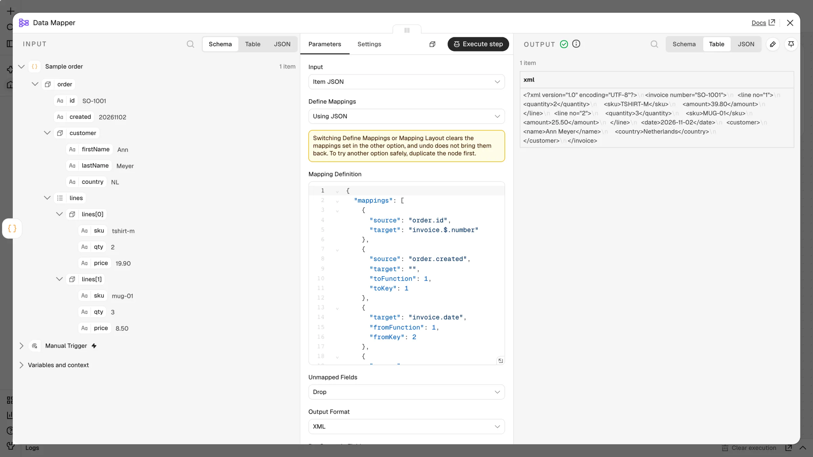

# Functions

Functions transform values between the source and the target when a single transform is not enough: they can take several inputs, give several outputs, count and total across records, or look values up. They are part of a **JSON definition** (**Define Mappings → Using JSON**), available from version 0.5.0.

Every function runs the same whether you write the JSON by hand (**Using JSON**) or draw it on the [Visual Mapper canvas](Visual-Mapper.md). The canvas is only a way to build the definition; it needs no plugin to run, and all functions stay available in **Using JSON** without one.



## How a definition with functions looks

Add a `functions` list next to `mappings`. Each function has a `key` (unique in the definition), a `type`, its `inputs` and `outputs` (ports), and an optional `config`.

Mappings connect fields and functions:

- `toFunction` + `toKey` — sends a source field (or a fixed `value`) to an input port. `target` stays empty.
- `fromFunction` + `fromKey` — writes an output port to a target field. No `source`.

```json
{
  "mappings": [
    { "source": "order.customer.firstName", "target": "", "toFunction": 1, "toKey": 1 },
    { "source": "order.customer.lastName", "target": "", "toFunction": 1, "toKey": 2 },
    { "target": "invoice.customer.name", "fromFunction": 1, "fromKey": 3 },

    { "source": "order.lines[*].qty", "target": "", "toFunction": 2, "toKey": 1 },
    { "source": "order.lines[*].price", "target": "", "toFunction": 2, "toKey": 2 },
    { "target": "invoice.line[*].amount", "fromFunction": 2, "fromKey": 2 },

    { "target": "invoice.line[*].$.no", "fromFunction": 3, "fromKey": 2 }
  ],
  "functions": [
    {
      "key": 1, "type": "stringConcat",
      "inputs": [{ "key": 1, "name": "first" }, { "key": 2, "name": "last" }],
      "outputs": [{ "key": 3, "name": "Result" }],
      "config": { "delimiter": " ", "fixedLength": "" }
    },
    {
      "key": 2, "type": "mathMultiply",
      "inputs": [{ "key": 1, "name": "Value" }, { "key": 2, "name": "Value to Multiply", "default": "1" }],
      "outputs": [{ "key": 2, "name": "Result" }]
    },
    {
      "key": 3, "type": "lineItemIncrement",
      "inputs": [{ "key": 1, "name": "Increment Basis", "default": "1" }, { "key": 2, "name": "Reset Value" }],
      "outputs": [{ "key": 2, "name": "Result" }]
    }
  ]
}
```

Definitions without `functions` work exactly as before.

## Rules

- **A function never feeds another function directly.** Every mapping has a field on one side; a mapping with both `fromFunction` and `toFunction` is rejected. To chain steps, use a **User-Defined** function.
- **Records.** A function runs once for every element its inputs point to. With `order.lines[*].qty` as an input, it runs once per line, and an output mapped to `invoice.line[*].…` writes one value per line.
- **Input defaults.** An input `default` is used when the input is not mapped, or the mapped value is empty.
- **Empty results are left out.** When a result is empty, the target field is not written (it is absent, not `""`).
- **Numbers are exact.** Numeric functions calculate with exact decimals: `0.1 + 0.2` is `0.3`. A result that keeps trailing zeros, such as `8.6000`, stays text.
- **Port keys** are unique among a function's inputs and among its outputs. An input and an output may share a key; the mapping direction tells them apart.

## Function reference

Port keys below are the defaults; you can rename ports, and add or remove them where noted.

### Date

| `type` | Inputs | Output | Notes |
| --- | --- | --- | --- |
| `dateFormat` | 1 Date String, 2 Input Mask, 3 Output Mask | 2 | Masks use `yyyy MM dd HH mm ss SSS` (UTC). Text in single quotes is literal: `yyyy-MM-dd'T'HH:mm`. |
| `currentDate` | 1 Output Mask | 2 | The current date and time; ISO 8601 when the mask is empty. |

### Language

| `type` | Inputs | Output | Notes |
| --- | --- | --- | --- |
| `japaneseConvert` | 1 Original String | 2 | `config.from` / `config.to`: `hiragana`, `katakanaFull`, `katakanaHalf`. |

### Lookup

| `type` | Inputs | Output | Notes |
| --- | --- | --- | --- |
| `simpleLookup` | 1 Key | 1 Value | `config.rows`: `[{ "key": "US", "value": "United States" }]`. The first match wins; no match leaves the field out. |

### Numeric

| `type` | Inputs | Output | Notes |
| --- | --- | --- | --- |
| `mathAbs`, `mathCeil`, `mathFloor` | 1 Value | 2 | Absolute value, round up, round down. |
| `mathAdd`, `mathSubtract`, `mathMultiply`, `mathDivide` | 1 Value, 2 operand | 2 | Divide gives 10 decimal places, half up. Division by zero fails. |
| `mathPrecision` | 1 Value, 2 Number of Precision | 2 | Rounds half up and pads with zeros: `8.6` at 4 → `8.6000`. |
| `numberFormat` | 1 Number String, 2 Input Mask, 3 Output Mask | 2 | Masks such as `#,##0.00`. The result is text. |
| `runningTotal` | 1 Value to Sum | 2 | Cumulative total, one value per record. |
| `sum` | 1 Value to Sum, 2 Reset Value | 2 | One total per unique Reset Value. Into a list, one row per group; into a single field with several groups, one output item per group. |
| `count` | 1 Field to Count, 2 Reset Value | 2 | Counts records where the field exists, per unique Reset Value. |
| `lineItemIncrement` | 1 Increment Basis, 2 Reset Value | 2 | 1, 2, 3, … per record. Restarts when the Reset Value changes from the previous record. Without mapped inputs, numbers the target rows. |
| `sequentialValue` | 1 Value | 2 | A counter that continues across executions. `config`: `keyName`, `fixedLength` (zero-padded, cut to the low digits), `batchSize`. |

### String

| `type` | Inputs | Output | Notes |
| --- | --- | --- | --- |
| `leftTrim`, `rightTrim` | 1 Original String, 2 Fix to Length | 3 | Keep the rightmost / leftmost N characters. `0` gives an empty result. |
| `whitespaceTrim` | 1 Original String | 2 | Removes leading and trailing whitespace. |
| `stringAppend`, `stringPrepend` | 1 Original String, 2 Fix to Length, 3 fill | 2 | Pads to the length with a repeating fill, or cuts to it. |
| `stringConcat` | 1…N (add more) | 3 | Joins inputs in order. `config.delimiter`, `config.fixedLength`. An empty input keeps its delimiters. |
| `stringReplace` | 1 Original String, 2 String to Search, 3 String to Replace | 4 | Regular expression, every match. `$1` inserts a group. |
| `stringRemove` | 1 Original String, 2 String to Remove | 3 | Removes every match of a regular expression. |
| `toLower`, `toUpper` | 1 Original String | 2 | |
| `stringSplit` | 1 Original String | 1…N (add more) | `config.mode`: `delimiter` (`config.delimiter`) or `length` (`config.splitLength`). More pieces than outputs fails. |

### User-Defined

A `userDefined` function chains steps; inside it, one step may feed the next. Steps run in the order listed.

```json
{
  "key": 4, "type": "userDefined", "name": "Clean name",
  "inputs": [{ "key": 1, "name": "in1" }],
  "outputs": [{ "key": 1, "name": "out1" }],
  "config": {
    "steps": [
      { "key": 1, "type": "whitespaceTrim", "inputs": [{ "key": 1, "name": "s" }], "outputs": [{ "key": 2, "name": "r" }] },
      { "key": 2, "type": "toUpper", "inputs": [{ "key": 1, "name": "s" }], "outputs": [{ "key": 2, "name": "r" }] }
    ],
    "links": [
      { "from": "in:1", "to": "step:1:1" },
      { "from": "step:1:2", "to": "step:2:1" },
      { "from": "step:2:2", "to": "out:1" }
    ]
  }
}
```

`links` go from `in:<input>` or `step:<step>:<output>` to `step:<step>:<input>` or `out:<output>`. Steps cannot be Sum, Count, counters or other User-Defined functions.

### Not available in the community node

**Scripting** (inline JavaScript or Python), **Data Table Lookup** and **SQL Lookup** need parts of n8n that community nodes may not use. A definition that contains them fails with a message that names the function.
